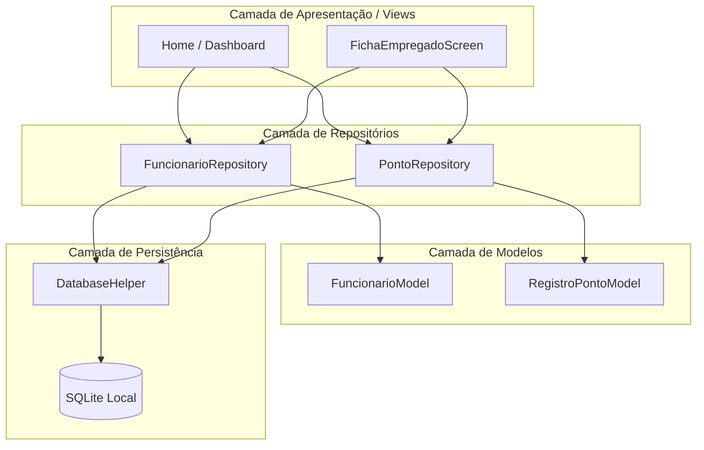

# Monte Glass 📱✨

**Monte Glass** é um aplicativo mobile desenvolvido em **Flutter** com persistência de dados local em **SQLite**, projetado especificamente para auxiliar no controle de ponto diário, gestão de funcionários/alunos, cálculo de salários baseados em dias trabalhados, e lançamento de vales ou descontos.

---

## 🚀 Funcionalidades Principais

* **Gestão de Funcionários / Alunos:** Cadastro, edição e listagem com definição de valor base de pagamento.
* **Controle de Ponto Inteligente:** Registo de horários de início e fim de expediente com armazenamento da data e dia da semana.
* **Ficha & Calendário de Ponto:** 
  * Visualização detalhada do histórico de dias trabalhados e vales lançados.
  * Marcação individual de status de pagamento (Pendente vs. Pago com indicador verde e texto riscado).
  * Botão de pagamento em massa para quitar todos os dias pendentes de uma só vez.
* **Gestão de Vales e Descontos:** Adição rápida de descontos com valores e observações personalizadas.
* **Suporte a Modo Paisagem (Horizontal):** Layout totalmente responsivo com `SingleChildScrollView` para evitar erros de *Bottom Overflow* quando o telemóvel é virado.

---

## 🏛️ Arquitetura do Projeto

O aplicativo segue uma arquitetura modular em camadas, separando a interface do utilizador, a regra de negócio/repositórios, os modelos de dados e a persistência local:



---

## 🛠️ Tecnologias Utilizadas

* **Flutter / Dart** (Framework multiplataforma)
* **sqflite** (Banco de dados relacional SQLite local)
* **intl** (Formatação de datas e internacionalização)

---

## 📦 Como Compilar e Gerar o APK

Para gerar a versão de produção (APK) para instalar no seu dispositivo Android, abra o terminal na raiz do projeto e execute:

```bash
flutter build apk --release
```

O arquivo executável estará disponível em:
```text
build/app/outputs/flutter-apk/app-release.apk
```

---

## ⚙️ Configuração do Ambiente de Desenvolvimento

1. Certifique-se de ter o **Flutter SDK** instalado na sua máquina.
2. Clone ou abra este repositório no seu editor (ex: **VS Code** ou **Android Studio**).
3. Instale as dependências do projeto executando:
   ```bash
   flutter pub get
   ```
4. Conecte um dispositivo Android via USB ou inicie um emulador.
5. Execute o aplicativo:
   ```bash
   flutter run
   ```

---

## 📄 Licença
Projeto desenvolvido para uso interno de gestão de ponto e pagamentos.
